### CI latency and runner cost

| Workflow | Merge-ready | First runner | Longest job | Runner time | Cost |
|:--|--:|--:|:--|--:|--:|
| CI | 4m 55s | after 3s | tests (3.11, windows-latest) · 4m 39s | 18 min | — |

```mermaid
%%{init: {"gantt": {"barHeight": 24, "barGap": 7, "topPadding": 50, "leftPadding": 250, "fontSize": 13, "sectionFontSize": 14}}}%%
gantt
    title CI jobs from workflow creation
    dateFormat X
    axisFormat %M:%S
    section Merge
    required gate elapsed :crit, merge_gate, 0, 295
    section Admission
    no runner assigned to this run :admission, 0, 3
    section Jobs
    distributions :crit, job_0, 3, 32
    quality :crit, job_1, 3, 14
    select-tests :job_2, 3, 14
    pytest-minimum :crit, job_3, 16, 47
    tests (3.11, macos-latest) :crit, job_4, 16, 86
    tests (3.11, ubuntu-latest) :crit, job_5, 16, 55
    tests (3.11, windows-latest) :crit, job_6, 16, 295
    tests (3.14, ubuntu-latest) :crit, job_7, 16, 45
    tests (3.14, windows-latest) :crit, job_8, 16, 176
    tests (3.14, macos-latest) :crit, job_9, 17, 89
```

Red bar: workflow creation to required gates done. Bars are observed API timestamps; they don't show dependencies.

Runner minutes and cost by runner and job

Estimated runner usage for this run: **18 rounded min** from **12.2 raw min**; **5.8 min (32%)** is per-job rounding.

| job | attempt | wall | rounded min | save 1 min | headroom |
|---|--:|--:|--:|--:|--:|
| tests (3.11, windows-latest) | 1 | 279s | 5 | 39s | 21s |
| tests (3.14, windows-latest) | 1 | 160s | 3 | 40s | 20s |
| tests (3.14, macos-latest) | 1 | 72s | 2 | 12s | 48s |
| tests (3.11, macos-latest) | 1 | 70s | 2 | 10s | 50s |
| tests (3.11, ubuntu-latest) | 1 | 39s | 1 | remove/consolidate | 21s |
| pytest-minimum | 1 | 31s | 1 | remove/consolidate | 29s |
| tests (3.14, ubuntu-latest) | 1 | 29s | 1 | remove/consolidate | 31s |
| distributions | 1 | 29s | 1 | remove/consolidate | 31s |
| select-tests | 1 | 11s | 1 | remove/consolidate | 49s |
| quality | 1 | 11s | 1 | remove/consolidate | 49s |

_The organization billing ledger is authoritative; this estimate applies a per-job minute ceiling to GitHub timestamps._

<!-- ci-observability-snapshot {"run_id":39848431314,"run_attempt":1,"completed_gates":9,"observed_at":"2026-10-22T20:28:45.552388Z"} -->
<!-- ci-observability-v1 -->
[run 39848431314](https://github.com/gigaverse-app/pytest-selective/actions/runs/39848431314) · schema `ci-observability/v1`