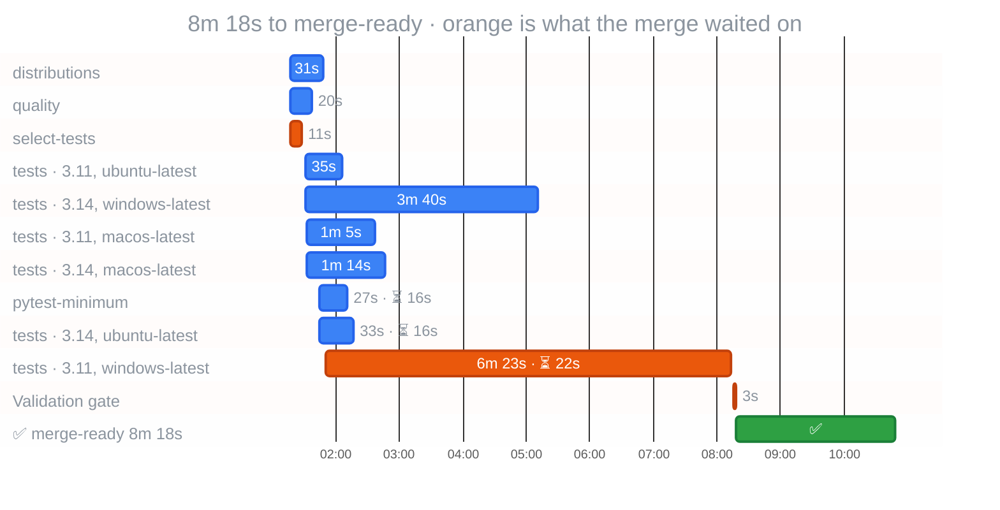

<a href="https://github.com/gigaverse-app/ci-esta"><picture><source media="(prefers-color-scheme: dark)" srcset="https://raw.githubusercontent.com/gigaverse-app/ci-esta/main/docs/assets/sticky-banner-dark.svg"></picture></a>

  &nbsp; CI · `b20f8ac`

#### ⏱️ CI time and cost

| Workflow | Merge-ready | First runner | Longest job | Runner time | Cost |
|:--|--:|--:|:--|--:|--:|
| CI | 8m 18s | after 1m 17s | tests (3.11, windows-latest) · 6m 23s | 22 min | — |

⏳: job creation-to-start delay, including scheduling/admission. Orange: the critical path through the workflow's `needs` graph. Bars are observed API timestamps.

### Critical path

Observed dependency chain (8m 18s): select-tests → tests (3.11, windows-latest) → Validation gate

Execution-only CPM (6m 37s): select-tests → tests (3.11, windows-latest) → Validation gate

| Job | Execution (s) | Delay after prerequisites (s) | Execution slack (s) |
| --- | ---: | ---: | ---: |
| select-tests | 11 | 77 | 0 |
| quality | 20 | 77 | 374 |
| distributions | 31 | 77 | 363 |
| tests (3.11, macos-latest) | 65 | 4 | 318 |
| tests (3.11, ubuntu-latest) | 35 | 3 | 348 |
| tests (3.11, windows-latest) | 383 | 22 | 0 |
| tests (3.14, macos-latest) | 74 | 4 | 309 |
| tests (3.14, ubuntu-latest) | 33 | 16 | 350 |
| tests (3.14, windows-latest) | 220 | 3 | 163 |
| pytest-minimum | 27 | 16 | 356 |
| Validation gate | 3 | 2 | 0 |

Delay includes scheduling, runner admission and other waits; it is not isolated queue time. Execution CPM holds measured durations constant and excludes those delays. The declared DAG must cover every prerequisite; this analysis does not assert validation success.

Runner minutes and cost by runner and job

Estimated runner usage for this run: **22 rounded min** from **15.0 raw min**; **7.0 min (32%)** is per-job rounding.

| job | attempt | wall | rounded min | save 1 min | headroom |
|---|--:|--:|--:|--:|--:|
| tests (3.11, windows-latest) | 1 | 383s | 7 | 23s | 37s |
| tests (3.14, windows-latest) | 1 | 220s | 4 | 40s | 20s |
| tests (3.14, macos-latest) | 1 | 74s | 2 | 14s | 46s |
| tests (3.11, macos-latest) | 1 | 65s | 2 | 5s | 55s |
| tests (3.11, ubuntu-latest) | 1 | 35s | 1 | remove/consolidate | 25s |
| tests (3.14, ubuntu-latest) | 1 | 33s | 1 | remove/consolidate | 27s |
| distributions | 1 | 31s | 1 | remove/consolidate | 29s |
| pytest-minimum | 1 | 27s | 1 | remove/consolidate | 33s |
| quality | 1 | 20s | 1 | remove/consolidate | 40s |
| select-tests | 1 | 11s | 1 | remove/consolidate | 49s |
| Validation gate | 1 | 3s | 1 | remove/consolidate | 57s |

_The organization billing ledger is authoritative; this estimate applies a per-job minute ceiling to GitHub timestamps._

Slowest step in each job

| job | result | job time | slowest timed step | step time |
|---|---|--:|---|--:|
| [`tests (3.11, windows-latest)`](https://github.com/gigaverse-app/pytest-selective/actions/runs/39862718435/job/120117786300) | success | 383s (complete) | `Run uv run --locked pytest -q -n 4 --durations=20 --cov --cov-report=term-missing --cov-report=xml` | 345s (complete) |
| [`tests (3.14, windows-latest)`](https://github.com/gigaverse-app/pytest-selective/actions/runs/39862718435/job/120117786212) | success | 220s (complete) | `Run uv run --locked pytest -q -n 4 --durations=20 --cov --cov-report=term-missing --cov-report=xml` | 188s (complete) |
| [`tests (3.14, macos-latest)`](https://github.com/gigaverse-app/pytest-selective/actions/runs/39862718435/job/120117786226) | success | 74s (complete) | `Run uv run --locked pytest -q -n 4 --durations=20 --cov --cov-report=term-missing --cov-report=xml` | 52s (complete) |
| [`tests (3.11, macos-latest)`](https://github.com/gigaverse-app/pytest-selective/actions/runs/39862718435/job/120117786209) | success | 65s (complete) | `Run uv run --locked pytest -q -n 4 --durations=20 --cov --cov-report=term-missing --cov-report=xml` | 47s (complete) |
| [`tests (3.11, ubuntu-latest)`](https://github.com/gigaverse-app/pytest-selective/actions/runs/39862718435/job/120117786192) | success | 35s (complete) | `Run uv run --locked pytest -q -n 4 --durations=20 --cov --cov-report=term-missing --cov-report=xml` | 21s (complete) |
| [`tests (3.14, ubuntu-latest)`](https://github.com/gigaverse-app/pytest-selective/actions/runs/39862718435/job/120117786238) | success | 33s (complete) | `Run uv run --locked pytest -q -n 4 --durations=20 --cov --cov-report=term-missing --cov-report=xml` | 19s (complete) |
| [`distributions`](https://github.com/gigaverse-app/pytest-selective/actions/runs/39862718435/job/120117692032) | success | 31s (complete) | `Run uv run --locked python scripts/smoke_distribution.py` | 15s (complete) |
| [`pytest-minimum`](https://github.com/gigaverse-app/pytest-selective/actions/runs/39862718435/job/120117786116) | success | 27s (complete) | `Run uv run --no-sync pytest -q -n 4 --durations=20` | 15s (complete) |
| [`quality`](https://github.com/gigaverse-app/pytest-selective/actions/runs/39862718435/job/120117691668) | success | 20s (complete) | `Run gigaverse-app/ci-esta/.github/actions/setup-cached-uv@78e5e2b078ce6d9b4df488a102c387f3548aa00a` | 5s (complete) |
| [`select-tests`](https://github.com/gigaverse-app/pytest-selective/actions/runs/39862718435/job/120117692092) | success | 11s (complete) | `Run ./.github/actions/plan-lanes` | 6s (complete) |
| [`Validation gate`](https://github.com/gigaverse-app/pytest-selective/actions/runs/39862718435/job/120120651755) | success | 3s (complete) | `Set up job` | 1s (complete) |

_Latest attempt only. All observed steps are retained in the JSON report. Unavailable timestamps are not zero; accrued time is measured at the snapshot. Step times explain job time and are not added to runner usage._

<!-- ci-observability-snapshot {"run_id":39862718435,"run_attempt":1,"completed_gates":1,"observed_at":"2026-10-22T22:19:39.672563Z"} -->
<!-- ci-observability-v1 -->
 Powered by [CI-esta](https://github.com/gigaverse-app/ci-esta): Let proven work rest. Measure the rest. · [Reading this report](https://github.com/gigaverse-app/ci-esta/blob/main/docs/github-actions-observability.md) · [run 39862718435](https://github.com/gigaverse-app/pytest-selective/actions/runs/39862718435) · schema `ci-observability/v1`