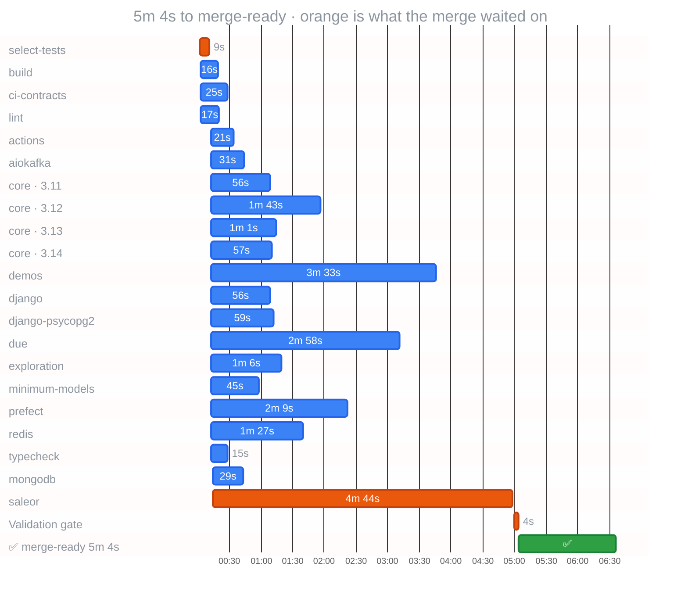

<a href="https://github.com/gigaverse-app/ci-esta"><picture><source media="(prefers-color-scheme: dark)" srcset="https://raw.githubusercontent.com/gigaverse-app/ci-esta/main/docs/assets/sticky-banner-dark.svg"></picture></a>

  &nbsp; CI · `fbffc6e`

#### ⏱️ CI time and cost

| Workflow | Merge-ready | First runner | Longest job | Runner time | Cost |
|:--|--:|--:|:--|--:|--:|
| CI | 5m 4s | after 2s | saleor · 4m 44s | 37 min | — |

⏳: job creation-to-start delay, including scheduling/admission. Orange: the critical path through the workflow's `needs` graph. Bars are observed API timestamps.

### Critical path

Observed dependency chain (5m 4s): select-tests → saleor → Validation gate

Execution-only CPM (4m 57s): select-tests → saleor → Validation gate

| Job | Execution (s) | Delay after prerequisites (s) | Execution slack (s) |
| --- | ---: | ---: | ---: |
| select-tests | 9 | 2 | 0 |
| ci-contracts | 25 | 3 | 268 |
| lint | 17 | 3 | 276 |
| build | 16 | 3 | 277 |
| typecheck | 15 | 2 | 269 |
| core (3.11) | 56 | 2 | 228 |
| core (3.12) | 103 | 2 | 181 |
| core (3.13) | 61 | 2 | 223 |
| core (3.14) | 57 | 2 | 227 |
| minimum-models | 45 | 2 | 239 |
| exploration | 66 | 2 | 218 |
| django | 56 | 2 | 228 |
| django-psycopg2 | 59 | 2 | 225 |
| redis | 87 | 2 | 197 |
| mongodb | 29 | 3 | 255 |
| aiokafka | 31 | 2 | 253 |
| prefect | 129 | 2 | 155 |
| demos | 213 | 2 | 71 |
| saleor | 284 | 3 | 0 |
| actions | 21 | 2 | 263 |
| due | 178 | 2 | 106 |
| Validation gate | 4 | 2 | 0 |

Delay includes scheduling, runner admission and other waits; it is not isolated queue time. Execution CPM holds measured durations constant and excludes those delays. The declared DAG must cover every prerequisite; this analysis does not assert validation success.

Runner minutes and cost by runner and job

Estimated runner usage for this run: **37 rounded min** from **26.0 raw min**; **11.0 min (30%)** is per-job rounding.

| job | attempt | wall | rounded min | save 1 min | headroom |
|---|--:|--:|--:|--:|--:|
| saleor | 1 | 284s | 5 | 44s | 16s |
| demos | 1 | 213s | 4 | 33s | 27s |
| due | 1 | 178s | 3 | 58s | 2s |
| prefect | 1 | 129s | 3 | 9s | 51s |
| core (3.12) | 1 | 103s | 2 | 43s | 17s |
| redis | 1 | 87s | 2 | 27s | 33s |
| exploration | 1 | 66s | 2 | 6s | 54s |
| core (3.13) | 1 | 61s | 2 | 1s | 59s |
| django-psycopg2 | 1 | 59s | 1 | remove/consolidate | 1s |
| core (3.14) | 1 | 57s | 1 | remove/consolidate | 3s |
| django | 1 | 56s | 1 | remove/consolidate | 4s |
| core (3.11) | 1 | 56s | 1 | remove/consolidate | 4s |
| minimum-models | 1 | 45s | 1 | remove/consolidate | 15s |
| aiokafka | 1 | 31s | 1 | remove/consolidate | 29s |
| mongodb | 1 | 29s | 1 | remove/consolidate | 31s |
| ci-contracts | 1 | 25s | 1 | remove/consolidate | 35s |
| actions | 1 | 21s | 1 | remove/consolidate | 39s |
| lint | 1 | 17s | 1 | remove/consolidate | 43s |
| build | 1 | 16s | 1 | remove/consolidate | 44s |
| typecheck | 1 | 15s | 1 | remove/consolidate | 45s |
| select-tests | 1 | 9s | 1 | remove/consolidate | 51s |
| Validation gate | 1 | 4s | 1 | remove/consolidate | 56s |

_The organization billing ledger is authoritative; this estimate applies a per-job minute ceiling to GitHub timestamps._

Slowest step in each job

| job | result | job time | slowest timed step | step time |
|---|---|--:|---|--:|
| [`saleor`](https://github.com/gigaverse-app/pytest-obligation/actions/runs/39920641011/job/120304811056) | success | 284s (complete) | `Saleor checkout` | 222s (complete) |
| [`demos`](https://github.com/gigaverse-app/pytest-obligation/actions/runs/39920641011/job/120304810987) | success | 213s (complete) | `Wagtail on django-tasks-db` | 64s (complete) |
| [`due`](https://github.com/gigaverse-app/pytest-obligation/actions/runs/39920641011/job/120304810880) | success | 178s (complete) | `Run complete work-table and application conformance` | 86s (complete) |
| [`prefect`](https://github.com/gigaverse-app/pytest-obligation/actions/runs/39920641011/job/120304810865) | success | 129s (complete) | `Run uv run --no-sync pytest package/tests/prefect integration_tests/prefect -q --due-work-explore=smoke --due-work-check-fixtures --due-work-require-assessed --due-work-profile-report=profiles-prefect.json --junitxml=adopters-prefect.xml --durations=20` | 111s (complete) |
| [`core (3.12)`](https://github.com/gigaverse-app/pytest-obligation/actions/runs/39920641011/job/120304810886) | success | 103s (complete) | `Prove package-only core controls need no application checkout` | 46s (complete) |
| [`redis`](https://github.com/gigaverse-app/pytest-obligation/actions/runs/39920641011/job/120304810860) | success | 87s (complete) | `Run uv run --no-sync pytest package/tests/rq package/tests/celery_worker integration_tests/rq integration_tests/celery_worker -p no:django -rxX -n 4 --durations=10 --due-work-explore=smoke --due-work-check-fixtures --due-work-require-assessed --due-work-profile-report=profiles-redis.json --junitxml=adopters-redis.xml` | 64s (complete) |
| [`exploration`](https://github.com/gigaverse-app/pytest-obligation/actions/runs/39920641011/job/120304810821) | success | 66s (complete) | `Run uv run --no-sync pytest package/tests/core integration_tests/core` | 51s (complete) |
| [`core (3.13)`](https://github.com/gigaverse-app/pytest-obligation/actions/runs/39920641011/job/120304811040) | success | 61s (complete) | `Run uv run --python 3.13 --no-sync pytest package/tests/core integration_tests/core --junitxml=test-timings.xml -o junit_family=xunit1` | 40s (complete) |
| [`django-psycopg2`](https://github.com/gigaverse-app/pytest-obligation/actions/runs/39920641011/job/120304810824) | success | 59s (complete) | `Run uv run --no-sync pytest package/tests/django examples/adopter/tests_django --ds=tests.django.settings -n 4` | 34s (complete) |
| [`core (3.14)`](https://github.com/gigaverse-app/pytest-obligation/actions/runs/39920641011/job/120304810905) | success | 57s (complete) | `Run uv run --python 3.14 --no-sync pytest package/tests/core integration_tests/core --junitxml=test-timings.xml -o junit_family=xunit1` | 36s (complete) |
| [`core (3.11)`](https://github.com/gigaverse-app/pytest-obligation/actions/runs/39920641011/job/120304811051) | success | 56s (complete) | `Run uv run --python 3.11 --no-sync pytest package/tests/core integration_tests/core --junitxml=test-timings.xml -o junit_family=xunit1` | 41s (complete) |
| [`django`](https://github.com/gigaverse-app/pytest-obligation/actions/runs/39920641011/job/120304811073) | success | 56s (complete) | `Run uv run --no-sync pytest package/tests/django examples/adopter/tests_django --ds=tests.django.settings -n 4` | 30s (complete) |
| [`minimum-models`](https://github.com/gigaverse-app/pytest-obligation/actions/runs/39920641011/job/120304810850) | success | 45s (complete) | `Run uv run --no-sync pytest package/tests/core integration_tests/core` | 34s (complete) |
| [`aiokafka`](https://github.com/gigaverse-app/pytest-obligation/actions/runs/39920641011/job/120304810979) | success | 31s (complete) | `Initialize containers` | 12s (complete) |
| [`mongodb`](https://github.com/gigaverse-app/pytest-obligation/actions/runs/39920641011/job/120304811169) | success | 29s (complete) | `Run docker run -d --name due-work-mongodb -p 27017:27017 mongo:7 --replSet dwh --bind_ip_all` | 9s (complete) |
| [`ci-contracts`](https://github.com/gigaverse-app/pytest-obligation/actions/runs/39920641011/job/120304748231) | success | 25s (complete) | `Prove consumer routing and documentation checks` | 10s (complete) |
| [`actions`](https://github.com/gigaverse-app/pytest-obligation/actions/runs/39920641011/job/120304810866) | success | 21s (complete) | `Generated histories also support optional search` | 5s (complete) |
| [`lint`](https://github.com/gigaverse-app/pytest-obligation/actions/runs/39920641011/job/120304748108) | success | 17s (complete) | `Run gigaverse-app/ci-esta/.github/actions/setup-cached-uv@6914acabd398fdcef929719370257277f483dc7d` | 6s (complete) |
| [`build`](https://github.com/gigaverse-app/pytest-obligation/actions/runs/39920641011/job/120304748048) | success | 16s (complete) | `Run uv build --project package --out-dir dist` | 3s (complete) |
| [`typecheck`](https://github.com/gigaverse-app/pytest-obligation/actions/runs/39920641011/job/120304810656) | success | 15s (complete) | `Run uv sync --all-packages --locked --all-extras --group demos` | 3s (complete) |
| [`select-tests`](https://github.com/gigaverse-app/pytest-obligation/actions/runs/39920641011/job/120304747888) | success | 9s (complete) | `Run gigaverse-app/pytest-selective/.github/actions/plan-lanes@6c65e923adf9e4283ba64c0db994304b3d426031` | 3s (complete) |
| [`Validation gate`](https://github.com/gigaverse-app/pytest-obligation/actions/runs/39920641011/job/120306588569) | success | 4s (complete) | `Set up job` | 1s (complete) |

_Latest attempt only. All observed steps are retained in the JSON report. Unavailable timestamps are not zero; accrued time is measured at the snapshot. Step times explain job time and are not added to runner usage._

<!-- ci-observability-snapshot {"run_id":39920641011,"run_attempt":1,"completed_gates":1,"observed_at":"2026-10-23T07:57:35.990790Z"} -->
<!-- ci-observability-v1 -->
 Powered by [CI-esta](https://github.com/gigaverse-app/ci-esta): Let proven work rest. Measure the rest. · [Reading this report](https://github.com/gigaverse-app/ci-esta/blob/main/docs/github-actions-observability.md) · [run 39920641011](https://github.com/gigaverse-app/pytest-obligation/actions/runs/39920641011) · schema `ci-observability/v1`