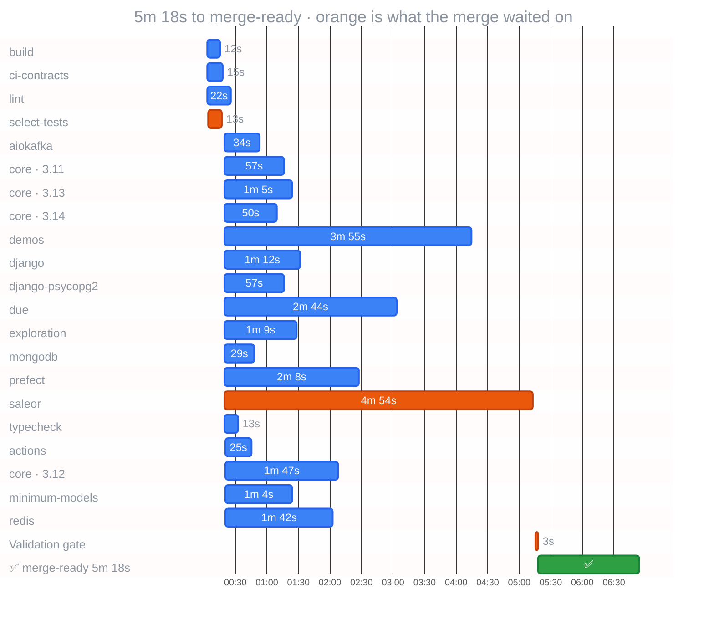

<a href="https://github.com/gigaverse-app/ci-esta"><picture><source media="(prefers-color-scheme: dark)" srcset="https://raw.githubusercontent.com/gigaverse-app/ci-esta/main/docs/assets/sticky-banner-dark.svg"></picture></a>

  &nbsp; CI · `a3b06ae`

#### ⏱️ CI time and cost

| Workflow | Merge-ready | First runner | Longest job | Runner time | Cost |
|:--|--:|--:|:--|--:|--:|
| CI | 5m 18s | after 3s | saleor · 4m 54s | 80 min | — |

⏳: job creation-to-start delay, including scheduling/admission. Orange: the critical path through the workflow's `needs` graph. Bars are observed API timestamps.

### Critical path

Observed dependency chain (5m 18s): select-tests → saleor → Validation gate

Execution-only CPM (5m 10s): select-tests → saleor → Validation gate

| Job | Execution (s) | Delay after prerequisites (s) | Execution slack (s) |
| --- | ---: | ---: | ---: |
| select-tests | 13 | 4 | 0 |
| ci-contracts | 15 | 3 | 292 |
| lint | 22 | 3 | 285 |
| build | 12 | 3 | 295 |
| typecheck | 13 | 2 | 281 |
| core (3.11) | 57 | 2 | 237 |
| core (3.12) | 107 | 3 | 187 |
| core (3.13) | 65 | 2 | 229 |
| core (3.14) | 50 | 2 | 244 |
| minimum-models | 64 | 3 | 230 |
| exploration | 69 | 2 | 225 |
| django | 72 | 2 | 222 |
| django-psycopg2 | 57 | 2 | 237 |
| redis | 102 | 3 | 192 |
| mongodb | 29 | 2 | 265 |
| aiokafka | 34 | 2 | 260 |
| prefect | 128 | 2 | 166 |
| demos | 235 | 2 | 59 |
| saleor | 294 | 2 | 0 |
| actions | 25 | 3 | 269 |
| due | 164 | 2 | 130 |
| Validation gate | 3 | 2 | 0 |

Delay includes scheduling, runner admission and other waits; it is not isolated queue time. Execution CPM holds measured durations constant and excludes those delays. The declared DAG must cover every prerequisite; this analysis does not assert validation success.

Runner minutes and cost by runner and job

Estimated runner usage for this run: **80 rounded min** from **56.3 raw min**; **23.7 min (30%)** is per-job rounding.

_Includes workflow attempts: 1, 2._

| job | attempt | wall | rounded min | save 1 min | headroom |
|---|--:|--:|--:|--:|--:|
| saleor | 1 | 451s | 8 | 31s | 29s |
| saleor | 2 | 294s | 5 | 54s | 6s |
| demos | 2 | 235s | 4 | 55s | 5s |
| demos | 1 | 213s | 4 | 33s | 27s |
| due | 1 | 168s | 3 | 48s | 12s |
| due | 2 | 164s | 3 | 44s | 16s |
| prefect | 2 | 128s | 3 | 8s | 52s |
| prefect | 1 | 113s | 2 | 53s | 7s |
| core (3.12) | 1 | 111s | 2 | 51s | 9s |
| core (3.12) | 2 | 107s | 2 | 47s | 13s |
| redis | 2 | 102s | 2 | 42s | 18s |
| redis | 1 | 98s | 2 | 38s | 22s |
| exploration | 1 | 75s | 2 | 15s | 45s |
| django | 2 | 72s | 2 | 12s | 48s |
| exploration | 2 | 69s | 2 | 9s | 51s |
| django | 1 | 69s | 2 | 9s | 51s |
| core (3.13) | 2 | 65s | 2 | 5s | 55s |
| minimum-models | 1 | 64s | 2 | 4s | 56s |
| minimum-models | 2 | 64s | 2 | 4s | 56s |
| django-psycopg2 | 1 | 61s | 2 | 1s | 59s |
| core (3.13) | 1 | 58s | 1 | remove/consolidate | 2s |
| django-psycopg2 | 2 | 57s | 1 | remove/consolidate | 3s |
| core (3.11) | 2 | 57s | 1 | remove/consolidate | 3s |
| core (3.11) | 1 | 54s | 1 | remove/consolidate | 6s |
| core (3.14) | 2 | 50s | 1 | remove/consolidate | 10s |
| core (3.14) | 1 | 49s | 1 | remove/consolidate | 11s |
| aiokafka | 1 | 39s | 1 | remove/consolidate | 21s |
| aiokafka | 2 | 34s | 1 | remove/consolidate | 26s |
| mongodb | 1 | 32s | 1 | remove/consolidate | 28s |
| mongodb | 2 | 29s | 1 | remove/consolidate | 31s |
| actions | 2 | 25s | 1 | remove/consolidate | 35s |
| lint | 2 | 22s | 1 | remove/consolidate | 38s |
| actions | 1 | 19s | 1 | remove/consolidate | 41s |
| ci-contracts | 1 | 18s | 1 | remove/consolidate | 42s |
| typecheck | 1 | 16s | 1 | remove/consolidate | 44s |
| ci-contracts | 2 | 15s | 1 | remove/consolidate | 45s |
| typecheck | 2 | 13s | 1 | remove/consolidate | 47s |
| select-tests | 2 | 13s | 1 | remove/consolidate | 47s |
| lint | 1 | 13s | 1 | remove/consolidate | 47s |
| select-tests | 1 | 12s | 1 | remove/consolidate | 48s |
| build | 1 | 12s | 1 | remove/consolidate | 48s |
| build | 2 | 12s | 1 | remove/consolidate | 48s |
| Validation gate | 1 | 3s | 1 | remove/consolidate | 57s |
| Validation gate | 2 | 3s | 1 | remove/consolidate | 57s |

_The organization billing ledger is authoritative; this estimate applies a per-job minute ceiling to GitHub timestamps._

Slowest step in each job

| job | result | job time | slowest timed step | step time |
|---|---|--:|---|--:|
| [`saleor`](https://github.com/gigaverse-app/pytest-obligation/actions/runs/39919031768/job/120304991829) | success | 294s (complete) | `Saleor checkout` | 242s (complete) |
| [`demos`](https://github.com/gigaverse-app/pytest-obligation/actions/runs/39919031768/job/120304991755) | success | 235s (complete) | `Wagtail on django-tasks-db` | 82s (complete) |
| [`due`](https://github.com/gigaverse-app/pytest-obligation/actions/runs/39919031768/job/120304991768) | success | 164s (complete) | `Run complete work-table and application conformance` | 98s (complete) |
| [`prefect`](https://github.com/gigaverse-app/pytest-obligation/actions/runs/39919031768/job/120304991807) | success | 128s (complete) | `Run uv run --no-sync pytest package/tests/prefect integration_tests/prefect -q --due-work-explore=smoke --due-work-check-fixtures --due-work-require-assessed --due-work-profile-report=profiles-prefect.json --junitxml=adopters-prefect.xml --durations=20` | 116s (complete) |
| [`core (3.12)`](https://github.com/gigaverse-app/pytest-obligation/actions/runs/39919031768/job/120304991720) | success | 107s (complete) | `Prove package-only core controls need no application checkout` | 45s (complete) |
| [`redis`](https://github.com/gigaverse-app/pytest-obligation/actions/runs/39919031768/job/120304991654) | success | 102s (complete) | `Run uv run --no-sync pytest package/tests/rq package/tests/celery_worker integration_tests/rq integration_tests/celery_worker -p no:django -rxX -n 4 --durations=10 --due-work-explore=smoke --due-work-check-fixtures --due-work-require-assessed --due-work-profile-report=profiles-redis.json --junitxml=adopters-redis.xml` | 74s (complete) |
| [`django`](https://github.com/gigaverse-app/pytest-obligation/actions/runs/39919031768/job/120304991681) | success | 72s (complete) | `Run uv run --no-sync pytest package/tests/django examples/adopter/tests_django --ds=tests.django.settings -n 4` | 41s (complete) |
| [`exploration`](https://github.com/gigaverse-app/pytest-obligation/actions/runs/39919031768/job/120304991641) | success | 69s (complete) | `Run uv run --no-sync pytest package/tests/core integration_tests/core` | 60s (complete) |
| [`core (3.13)`](https://github.com/gigaverse-app/pytest-obligation/actions/runs/39919031768/job/120304991705) | success | 65s (complete) | `Run uv run --python 3.13 --no-sync pytest package/tests/core integration_tests/core --junitxml=test-timings.xml -o junit_family=xunit1` | 46s (complete) |
| [`minimum-models`](https://github.com/gigaverse-app/pytest-obligation/actions/runs/39919031768/job/120304991599) | success | 64s (complete) | `Run uv run --no-sync pytest package/tests/core integration_tests/core` | 47s (complete) |
| [`core (3.11)`](https://github.com/gigaverse-app/pytest-obligation/actions/runs/39919031768/job/120304991684) | success | 57s (complete) | `Run uv run --python 3.11 --no-sync pytest package/tests/core integration_tests/core --junitxml=test-timings.xml -o junit_family=xunit1` | 38s (complete) |
| [`django-psycopg2`](https://github.com/gigaverse-app/pytest-obligation/actions/runs/39919031768/job/120304991976) | success | 57s (complete) | `Run uv run --no-sync pytest package/tests/django examples/adopter/tests_django --ds=tests.django.settings -n 4` | 35s (complete) |
| [`core (3.14)`](https://github.com/gigaverse-app/pytest-obligation/actions/runs/39919031768/job/120304991672) | success | 50s (complete) | `Run uv run --python 3.14 --no-sync pytest package/tests/core integration_tests/core --junitxml=test-timings.xml -o junit_family=xunit1` | 33s (complete) |
| [`aiokafka`](https://github.com/gigaverse-app/pytest-obligation/actions/runs/39919031768/job/120304991759) | success | 34s (complete) | `Initialize containers` | 20s (complete) |
| [`mongodb`](https://github.com/gigaverse-app/pytest-obligation/actions/runs/39919031768/job/120304991638) | success | 29s (complete) | `Run docker run -d --name due-work-mongodb -p 27017:27017 mongo:7 --replSet dwh --bind_ip_all` | 9s (complete) |
| [`actions`](https://github.com/gigaverse-app/pytest-obligation/actions/runs/39919031768/job/120304991783) | success | 25s (complete) | `Generated histories also support optional search` | 6s (complete) |
| [`lint`](https://github.com/gigaverse-app/pytest-obligation/actions/runs/39919031768/job/120304893969) | success | 22s (complete) | `actionlint` | 8s (complete) |
| [`ci-contracts`](https://github.com/gigaverse-app/pytest-obligation/actions/runs/39919031768/job/120304893534) | success | 15s (complete) | `Prove consumer routing and documentation checks` | 6s (complete) |
| [`select-tests`](https://github.com/gigaverse-app/pytest-obligation/actions/runs/39919031768/job/120304893940) | success | 13s (complete) | `Run gigaverse-app/pytest-selective/.github/actions/plan-lanes@6c65e923adf9e4283ba64c0db994304b3d426031` | 5s (complete) |
| [`typecheck`](https://github.com/gigaverse-app/pytest-obligation/actions/runs/39919031768/job/120304991712) | success | 13s (complete) | `Run uv sync --all-packages --locked --all-extras --group demos` | 3s (complete) |
| [`build`](https://github.com/gigaverse-app/pytest-obligation/actions/runs/39919031768/job/120304894065) | success | 12s (complete) | `Run uv build --project package --out-dir dist` | 2s (complete) |
| [`Validation gate`](https://github.com/gigaverse-app/pytest-obligation/actions/runs/39919031768/job/120306828654) | success | 3s (complete) | `Run gigaverse-app/ci-esta/.github/actions/validation-gate@6914acabd398fdcef929719370257277f483dc7d` | 1s (complete) |

_Latest attempt only. All observed steps are retained in the JSON report. Unavailable timestamps are not zero; accrued time is measured at the snapshot. Step times explain job time and are not added to runner usage._

<!-- ci-observability-snapshot {"run_id":39919031768,"run_attempt":2,"completed_gates":1,"observed_at":"2026-10-23T08:02:30.983907Z"} -->
<!-- ci-observability-v1 -->
 Powered by [CI-esta](https://github.com/gigaverse-app/ci-esta): Let proven work rest. Measure the rest. · [Reading this report](https://github.com/gigaverse-app/ci-esta/blob/main/docs/github-actions-observability.md) · [run 39919031768](https://github.com/gigaverse-app/pytest-obligation/actions/runs/39919031768) · schema `ci-observability/v1`