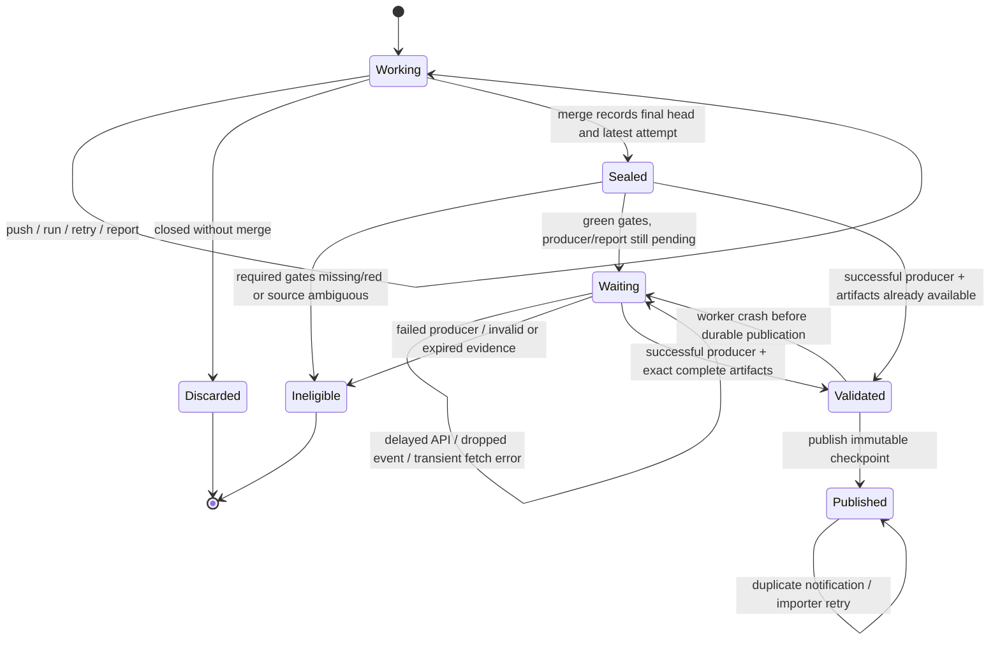

# Learn from the last validation of a merged PR

**Design contract; the collector and adoption default are not implemented yet.**
The default adoption should promote evidence from the final validation of a green,
merged PR. A working branch, an earlier PR revision, and a PR closed without merge
must never change shared baseline history. Running Python tests again on every
main push is unnecessary for learning those observations.

The executable design is [merged_pr_evidence.qnt](../specs/merged_pr_evidence.qnt)
and [timing_publication.qnt](../specs/timing_publication.qnt). CI checks the model;
it does not publish production evidence or change consumer workflows.

## The default and the meaning of last

At the merge boundary, seal the final PR head and **the latest admitted run and
attempt for each configured evidence producer/environment**. Order attempts by
their admission/start identity, with deterministic run/attempt tie breakers.
Do not order by completion time, artifact upload time, or webhook delivery time.
Do not search backward for the last *successful* run. A newer failed, cancelled,
pending, or uncertain attempt cannot be replaced by an older green result.

"Green" means all configured required validation gates passed for that sealed
final head/attempt, not that an unrelated deployment succeeded or the PR once had
a green badge. A manually bypassed merge does not confer evidence eligibility.
For the producer, require successful workflow completion as well: required gates
may finish before reporting, and reporting itself can fail.

This design deliberately freezes the source at merge time. A later post-merge
test rerun is not a replacement for what validated the PR. Retrying the importer
retries the same sealed source. Explicit full checkpoints are separate producers
with their own recorded identities. This avoids a moving meaning of "last".

## State machine



`Validated` means a local parsed snapshot, not a passing test receipt. If a worker
loses it, it must fetch and validate again. If the artifact expires after it was
validated and the snapshot survives, publication can finish from that snapshot.
If the only copy is gone, preserve the existing baseline and report the reason.
Do not rerun tests automatically just to manufacture timing history.

| Transition | Required evidence | Shared effect |
| --- | --- | --- |
| Working -> Sealed | Authoritative merged PR, destination, merge commit, final head, complete producer/attempt enumeration at merge cutoff | Persist source selection; no baseline update |
| Sealed -> Waiting | Green final gates; matching latest producer still finishing | Durable pending item |
| Waiting -> Validated | Successful exact producer, verified artifact IDs, schema/environment/whole-file completion | Parse observed measurements only |
| Validated -> Published | Same sealed source; trusted collector and idempotency key | Immutable checkpoint |
| Published -> Published | Repeated event or importer retry | No extra logical contribution |
| Any uncertain source | Missing proof, incomplete enumeration, invalid owner or incompatible lane | Keep existing estimates; no publication |

## Evidence types have different consumers

Timing observations are scheduling estimates. They never establish passing tests
on another revision, authorize dropping a file, or satisfy a required gate.
The existing [receipt resolver](evidence-reuse.md) owns validation reuse: it must
still establish exact declared inputs, execution context, freshness and the
absence of contradictory evidence. Promotion does not relax those checks.

Only successful merged-PR observations enter shared learning by this default.
Private PR artifacts can still support that PR's existing incremental validation;
that is a different scope from publishing shared baseline history. This design
does not remove the current PR-local receipt mechanism.

PR-head and merge commit trees can differ after squash/rebase or concurrent
merges. Preserve the actual tested SHA/tree; never relabel it as "tested main".
For scheduling, these measurements can remain advisory estimates of the files
that reached main. For validation reuse, a tree/input mismatch still executes
the affected validation. Filtering a timing path no longer present on main is
an inventory operation, not evidence that the remaining code passed.

## Identity and provenance

The sealed record needs repository identity, PR number, destination branch,
merge commit/time, final head/tree, configured workflow ID/path, environment key,
producer run/attempt and its admission time. Artifact records need exact IDs,
source run/attempt, schema, selection/completion manifest, original observation
time and file costs. The checkpoint also needs its own uploader run/attempt.
**Uploader identity and measurement identity must be separate fields.**

Repository/PR/head/producer/attempt/environment identifies one logical import.
Do not key by a mutable branch name or "latest successful". Source observation
stamps remain original during retries, delayed downloads and compaction. Main's
tracked-file inventory/removal clock is recorded independently of measurement
time, so importing an old report cannot revert the current inventory.

Read JUnit or a new explicit *observed-only* manifest. Existing PR duration files
can include inherited history; importing them wholesale falsely refreshes stale
files. Require every expected shard and the fixed lane's complete-file contract.
A bare JUnit file cannot prove that no cases were omitted. Partial test reruns
must identify retained shard producers explicitly; each observation keeps the
timestamp of the attempt that measured it. Never retag retained XML as freshly
measured merely because the aggregate reporter ran again.

The live spike found a successful merged PR run whose `pull_requests` array was
empty. Reuse CI-esta's merged-PR/ownership resolution rather than relying on that
array or inventing a second association policy. Resolve the merge commit's PR,
then verify final head and the configured producer's ownership/completion data.
Head equality alone does not establish which PR/workflow produced an artifact.

## Events, recovery and trust

Merge notification and producer completion both request reconciliation. Neither
event payload directly authorizes publication. Read current authoritative state,
apply the merge-time cutoff, and process the durable pending item. A bounded
catch-up pass finds missed notifications, including a merge that occurred before
the reporter finished. Pagination or an API failure must not silently exclude a
newer attempt and select an older one. If the merge-time attempt cannot be
reconstructed unambiguously, record an explicit ineligible result.

Current history readers admit successful main push/schedule/dispatch uploaders
and reject `workflow_run`. An implementation must either keep a trusted allowed
collector trigger or explicitly extend the shared producer policy to a named
completion observer. An observer executes trusted default-branch code, never PR
code, artifact scripts, or artifact-provided package installation commands.
Artifact ownership, bounded size/path parsing, source environment and completion
validation remain required regardless of trigger. Same-repository producers are
the initial policy; fork support needs its own validated trust contract.

Each collector writes an immutable checkpoint. Readers reconcile all uncovered
checkpoints using original observation ordering; concurrent writers must not
overwrite each other's unobserved files. Compaction may cover a checkpoint only
after reading it. Idempotent logical imports do not imply that the delivery
platform supplies exactly-once webhooks or executes only one physical upload.

Publication is best-effort reporting, outside the validation/deployment critical
path. It should report pending, rejected, expired and published counts/reasons.
Weekly full runs remain independent refreshes for files not exercised by ordinary
PRs. They are not the only source of fresh scheduling observations.

## What is modeled and checked

The lifecycle model has one PR, one producer/environment, two head revisions and
three immutable run/attempt slots. It allows pushes, overlapping attempts,
failed reporting after a green gate, merge before upload, invalid/expired
artifacts, crashes, duplicate publication, closed PRs and post-merge reruns.
The separate composition model has two already-admitted writers and three files,
including one shared file. It checks reverse completion, replay and partial
updates. Valid artifact/receipt predicates abstract the real parsing and identity
checks; the model does not prove the GitHub API adapter implements them.

The six lifecycle safety invariants require merged+green provenance, final-head
identity, the sealed latest attempt, successful validated evidence, at most one
logical import, and no timing-based validation reuse. Publication must preserve
every applied writer's newest per-file observation and accept only stored data.

Recovery liveness is checked separately from a ready merged source. With retained
artifacts, recurring reconciliation and a fair opportunity to finish publication,
it eventually publishes despite worker crashes. Without retry fairness, the
checker must find a counterexample. There is intentionally no unconditional
promise of progress through permanent API failure or expired-only evidence.

Deliberately broken transitions are checked as negative controls: publishing an
open PR, falling back to an older green attempt, treating timings as a receipt,
replacing history with one writer's partial data, and assuming progress without
reconciliation. A parser/tooling failure does not count as a counterexample.

## Reproduce

Install Node.js 22+ and Java 21, then run:

```bash
python specs/check.py
```

The runner pins Quint 0.33.1 and uses its TLC backend (through Apalache 0.62.4).
Java 21 is required by that Apalache distribution. It typechecks both models,
runs explicit scenarios, enumerates the finite state spaces, checks conditional
liveness, and requires counterexamples for every broken variant. Generated
checker output stays outside the repository. See the [Quint CLI](https://quint.sh/docs/quint)
for the distinction between random simulation, bounded checking and TLC's finite
state enumeration.

Local verification of this design enumerated 917,140 lifecycle states, nine
publication states and five recovery states. All 17 scenario tests passed.
These are results for the stated finite abstractions, not proof of an arbitrary
number of PRs or of an unimplemented Python collector.

## Implementation sequence

1. Implement source sealing/admission in CI-esta using existing ownership and
   receipt machinery. Preserve immutable per-attempt records needed at merge.
2. Implement observed-only import, separate source/uploader identity, durable
   pending work, completion/merge reconciliation and catch-up.
3. Connect model traces to the real Python state machine using
   pytest-quint-connect; exercise real API-boundary recordings, partial reruns,
   fork/ownership rejection, missing shards and unavailable APIs.
4. Publish under an experimental history key and verify a later real run reads
   it. Exercise merge-before-reporting and retry-after-upload in hosted Actions.
5. Make merged-PR promotion the default adoption path, including generated
   workflow examples, adoption checks and migration documentation. Preserve
   scheduled full checkpoints and exact receipt requirements. Only then remove
   consumer main-push test executions whose remaining purpose was learning.

No hosted publication, billing improvement, consumer rollout or implementation
conformance is claimed by this model-only change.
