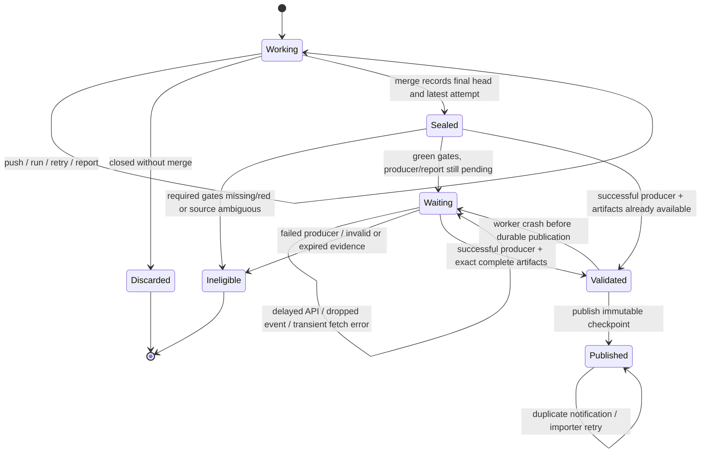

# Learn from the last validation of a merged PR

The default adoption promotes timing evidence from the final validation of a green,
merged PR. A working branch, an earlier PR revision, and a PR closed without merge
must never change shared baseline history. Running Python tests again on every
main push is unnecessary for learning those observations.

The executable design is [merged_pr_evidence.qnt](../specs/merged_pr_evidence.qnt)
and [timing_publication.qnt](../specs/timing_publication.qnt). The
[pytest-quint-connect contract](../contracts/merged_pr/contract.qnt) imports the
lifecycle model and replays histories through the real Python collector, HTTP
adapter, artifact parser and timing store. Adoption is explicit; installing a
new CI-esta version does not edit existing workflows.

## Adopt the default

Use the same environment key in `restore-test-timings`, the producer below, and
`promote-merged-pr-timings`. The latter is the lightweight shared-history writer.
Keep existing scheduled full checkpoints. All examples use `@v1`; adopt these new
inputs only after this implementation is released on that major tag.

After successful tests in the producer workflow:

```yaml
- name: "PR evidence #${{ github.event.pull_request.number }} head ${{ github.event.pull_request.head.sha }}"
  if: github.event_name == 'pull_request'
  run: 'true'
- uses: gigaverse-app/ci-esta/actions/learn-test-timings@v1
  with:
    junit-pattern: junit.xml
    artifact-name: unit-timings-${{ github.run_id }}-${{ github.run_attempt }}
    history-key: unit-linux-py314
    complete-files: 'true'
    fresh-reports: 'true'
    measurement-shard: all
    measurement-report-count: '1'
```

The ownership step must be in a top-level job; reuse an existing identical marker.
`fresh-reports` declares that **every XML input was measured in this attempt**.
Leave it false when aggregating retained XML from earlier attempts. For matrix
jobs, publish one manifest per named shard and configure every shard/report count
in the collector's `expected-shards` map. Shards must own disjoint complete files.
Changing marker filters or running arbitrary case subsets needs a different lane
contract, not a whole-file declaration. Keep observed manifest publication outside
required validation dependencies if timing-report failure should not block merging.

Copy [the collector workflow](../examples/timing-history/merged-pr-collector.yml)
as `.github/workflows/ci-esta-timing-history.yml`. Set the producer's display name
under `workflow_run`, its filename, exact validation gate job names, environment
key and expected shards. Every configured gate must succeed before merge. The
producer itself must eventually complete successfully. These are explicitly
configured gates in that producer workflow; CI-esta does not infer all repository
branch-protection rules or cross-workflow required checks.

The workflow collects the PR associated with the pushed merge commit. A trusted
completion observer passes its producer run ID to a manual collection, covering
merge-before-reporting. Neither event rescans every recent PR on every push.
An hourly catch-up recovers missed notifications for seven days; targeted manual
retry accepts a PR number. Catch-up skips already imported immutable sources.
Only the completion dispatcher needs `actions: write`; collection needs read
access to actions, PRs and contents. It never checks out PR code. Shared history
readers continue accepting successful trusted push/schedule/dispatch uploaders.

The collector parses at most 10 MB per artifact, verifies uploader repository,
exact source run/attempt/head, workflow, gate completion and expected shard counts,
and reads observed-only costs. A missing shard retains the old baseline and is
retried. Malformed or uncertain evidence produces an unavailable/rejected outcome.
Different environments cannot be combined. Explicit targeted retries still read
the original immutable source; publication time never replaces measurement time.

### Conservative boundaries

GitHub exposes a rerun's start timestamp, not durable queue admission. If an
attempt starts after merge, the collector cannot distinguish a post-merge rerun
from one queued before merge. Before the first successful import it declines that
source instead of selecting an older green attempt. Equal merge/admission/gate
timestamps are also ambiguous at GitHub's timestamp precision. Already imported
sources remain unchanged. Deleted attempt records and incomplete enumeration
similarly retain the baseline. These are missed learning opportunities, not reasons
to rerun tests or block a PR.

Partial reruns are supported only when every expected shard supplies fresh
measurements for the sealed attempt. This version does not import retained
cross-attempt XML; an explicit per-shard producer provenance format is needed
before that can be supported safely. Fork producers are excluded.

Provenance is retained in each checkpoint's `imports` map, separately from its
uploader. Publication is logically idempotent, but duplicate physical uploads are
possible. Concurrent checkpoints use the existing reconciliation contract.
Expired-only artifacts cannot be recovered. Source artifacts last 21 days and
history checkpoints 90 days, subject to repository retention limits.

## The default and the meaning of last

At the merge boundary, seal the final PR head and **the latest admitted run and
attempt for each configured evidence producer/environment**. Order attempts by
their admission/start identity, with deterministic run/attempt tie breakers.
Do not order by completion time, artifact upload time, or webhook delivery time.
Do not search backward for the last *successful* run. A newer failed, cancelled,
pending, or uncertain attempt cannot be replaced by an older green result.

"Green" means all configured required validation gates passed for that sealed
final head/attempt, not that an unrelated deployment succeeded or the PR once had
a green badge. A manually bypassed merge does not confer evidence eligibility.
For the producer, require successful workflow completion as well: required gates
may finish before reporting, and reporting itself can fail.

This design deliberately freezes the source at merge time. A later post-merge
test rerun is not a replacement for what validated the PR. Retrying the importer
retries the same sealed source. Explicit full checkpoints are separate producers
with their own recorded identities. This avoids a moving meaning of "last".

## State machine



`Validated` means a local parsed snapshot, not a passing test receipt. If a worker
loses it, it must fetch and validate again. If the artifact expires after it was
validated and the snapshot survives, publication can finish from that snapshot.
If the only copy is gone, preserve the existing baseline and report the reason.
Do not rerun tests automatically just to manufacture timing history.

| Transition | Required evidence | Shared effect |
| --- | --- | --- |
| Working -> Sealed | Authoritative merged PR, destination, merge commit, final head, complete producer/attempt enumeration at merge cutoff | Reconstruct source selection; no baseline update |
| Sealed -> Waiting | Green final gates; matching latest producer still finishing | GitHub merge/attempt records remain the durable pending inventory |
| Waiting -> Validated | Successful exact producer, verified artifact IDs, schema/environment/whole-file completion | Parse observed measurements only |
| Validated -> Published | Same sealed source; trusted collector and idempotency key | Immutable checkpoint |
| Published -> Published | Repeated event or importer retry | No extra logical contribution |
| Any uncertain source | Missing proof, incomplete enumeration, invalid owner or incompatible lane | Keep existing estimates; no publication |

## Evidence types have different consumers

Timing observations are scheduling estimates. They never establish passing tests
on another revision, authorize dropping a file, or satisfy a required gate.
The existing [receipt resolver](evidence-reuse.md) owns validation reuse: it must
still establish exact declared inputs, execution context, freshness and the
absence of contradictory evidence. Promotion does not relax those checks.

Only successful merged-PR observations enter shared learning by this default.
Private PR artifacts can still support that PR's existing incremental validation;
that is a different scope from publishing shared baseline history. This design
does not remove the current PR-local receipt mechanism.

PR-head and merge commit trees can differ after squash/rebase or concurrent
merges. Preserve the actual tested SHA/tree; never relabel it as "tested main".
For scheduling, these measurements can remain advisory estimates of the files
that reached main. For validation reuse, a tree/input mismatch still executes
the affected validation. Filtering a timing path no longer present on main is
an inventory operation, not evidence that the remaining code passed.

## Identity and provenance

The sealed record needs repository identity, PR number, destination branch,
merge commit/time, final head/tree, configured workflow ID/path, environment key,
producer run/attempt and its admission time. Artifact records need exact IDs,
source run/attempt, schema, selection/completion manifest, original observation
time and file costs. The checkpoint also needs its own uploader run/attempt.
**Uploader identity and measurement identity must be separate fields.**

Repository/PR/head/producer/attempt/environment identifies one logical import.
Do not key by a mutable branch name or "latest successful". Source observation
stamps remain original during retries, delayed downloads and compaction. Main's
tracked-file inventory/removal clock is recorded independently of measurement
time, so importing an old report cannot revert the current inventory.

Read JUnit or a new explicit *observed-only* manifest. Existing PR duration files
can include inherited history; importing them wholesale falsely refreshes stale
files. Require every expected shard and the fixed lane's complete-file contract.
A bare JUnit file cannot prove that no cases were omitted. Partial test reruns
must identify retained shard producers explicitly; each observation keeps the
timestamp of the attempt that measured it. Never retag retained XML as freshly
measured merely because the aggregate reporter ran again.

The live spike found a successful merged PR run whose `pull_requests` array was
empty. Reuse CI-esta's merged-PR/ownership resolution rather than relying on that
array. Read the authoritative merged PR record, then verify its final head and
the configured producer's existing `PR evidence #... head ...` ownership marker.
Head equality alone does not establish which PR/workflow produced an artifact.

## Events, recovery and trust

Merge notification and producer completion both request reconciliation. Neither
event payload directly authorizes publication. Read current authoritative state,
apply the merge-time cutoff, and reconstruct pending work from GitHub records. A bounded
catch-up pass finds missed notifications, including a merge that occurred before
the reporter finished. Pagination or an API failure must not silently exclude a
newer attempt and select an older one. If the merge-time attempt cannot be
reconstructed unambiguously, record an explicit ineligible result.

Current history readers admit successful main push/schedule/dispatch uploaders
and reject `workflow_run`. An implementation must either keep a trusted allowed
collector trigger or explicitly extend the shared producer policy to a named
completion observer. An observer executes trusted default-branch code, never PR
code, artifact scripts, or artifact-provided package installation commands.
Artifact ownership, bounded size/path parsing, source environment and completion
validation remain required regardless of trigger. Same-repository producers are
the initial policy; fork support needs its own validated trust contract.

Each collector writes an immutable checkpoint. Readers reconcile all uncovered
checkpoints using original observation ordering; concurrent writers must not
overwrite each other's unobserved files. Compaction may cover a checkpoint only
after reading it. Idempotent logical imports do not imply that the delivery
platform supplies exactly-once webhooks or executes only one physical upload.

Publication is best-effort reporting, outside the validation/deployment critical
path. It should report pending, rejected, expired and published counts/reasons.
Weekly full runs remain independent refreshes for files not exercised by ordinary
PRs. They are not the only source of fresh scheduling observations.

## What is modeled and checked

The lifecycle model has one PR, one producer/environment, two head revisions and
three immutable run/attempt slots. It allows pushes, overlapping attempts,
failed reporting after a green gate, merge before upload, invalid/expired
artifacts, crashes, duplicate publication, closed PRs and post-merge reruns.
The separate composition model has two already-admitted writers and three files,
including one shared file. It checks reverse completion, replay and partial
updates. Valid artifact/receipt predicates abstract the real parsing and identity
checks; the model does not prove the GitHub API adapter implements them.

The six lifecycle safety invariants require merged+green provenance, final-head
identity, the sealed latest attempt, successful validated evidence, at most one
logical import, and no timing-based validation reuse. Publication must preserve
every applied writer's newest per-file observation and accept only stored data.

Recovery liveness is checked separately from a ready merged source. With retained
artifacts, recurring reconciliation and a fair opportunity to finish publication,
it eventually publishes despite worker crashes. Without retry fairness, the
checker must find a counterexample. There is intentionally no unconditional
promise of progress through permanent API failure or expired-only evidence.

Deliberately broken transitions are checked as negative controls: publishing an
open PR, falling back to an older green attempt, treating timings as a receipt,
replacing history with one writer's partial data, and assuming progress without
reconciliation. A parser/tooling failure does not count as a counterexample.

## Reproduce

Install Node.js 22+ and Java 21, then run:

```bash
python specs/check.py
```

The runner pins Quint 0.33.1 and uses its TLC backend (through Apalache 0.62.4).
Java 21 is required by that Apalache distribution. It typechecks both models,
runs explicit scenarios, enumerates the finite state spaces, checks conditional
liveness, and requires counterexamples for every broken variant. Generated
checker output stays outside the repository. See the [Quint CLI](https://quint.sh/docs/quint)
for the distinction between random simulation, bounded checking and TLC's finite
state enumeration.

Local verification of this design enumerated 917,140 lifecycle states, nine
publication states and five recovery states. All 17 scenario tests passed.
These are results for the stated finite abstractions, not proof of an arbitrary
number of PRs. The separate model-connected contract checks the Python implementation
against sampled and named histories through an HTTP-boundary fixture.

## Implementation verification and rollout

```bash
UV_PROJECT_ENVIRONMENT=.venv-contracts uv sync --locked --no-default-groups --group contracts
UV_PROJECT_ENVIRONMENT=.venv-contracts uv run --no-sync pytest-quint-connect codegen contracts/merged_pr/quint-connect.json --check
UV_PROJECT_ENVIRONMENT=.venv-contracts uv run --no-sync pytest -c contracts/quint.ini contracts --quint-require-complete
```

The contract checks 100 sampled histories and four named histories, plus three
mutants and completeness. Mutants admit an open PR, fall back to an older green
run, or drop publication. At the committed seed, the latter two are caught by
named histories only. The driver observes actual staging and stored costs; it
does not calculate expected admission. Ordinary integration tests cover concrete
API/schema/ownership failures, trusted uploader admission, producer manifests and
collector-to-reader round trips. The finite model still abstracts external API
availability and receipt validation.

The live read-only spike selected gigaverse-ai PR #3367's actual source run
42994425766, attempt 1, through the new implementation. Its gate/ownership checks
passed; promotion correctly remained pending because that older run has no new
observed-only manifest. It did not import the inherited duration snapshot.

Before removing consumer main-push tests, publish this implementation, use an
experimental history key for one real merged producer PR, and verify a subsequent
hosted run restores the checkpoint. That hosted publish/restore journey and
consumer rollout are still required; local HTTP-boundary tests do not establish
GitHub permissions or artifact behavior in production. No billing savings are
claimed. Review the Quint specification as the statement of intended policy.
