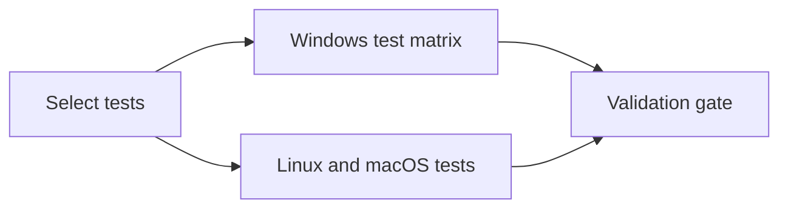

# Find the GitHub Actions job actually delaying your PR

Start with the required gate and follow its dependencies. The longest individual
step does not necessarily determine when a PR is ready: another branch may start
late, and several jobs may execute in sequence. Measure both execution and waiting
before changing caching or parallelism.

## 1. Collect one completed run

Install the reporter in an isolated tool environment:

```bash
uv tool install 'ci-esta>=1.1.0,<2'
```

Provide a GitHub read token through `GH_TOKEN` or `GITHUB_TOKEN` using your normal
credential mechanism. Do not put the token in a command argument or commit it.
Replace the repository, run, attempt, and gate with your actual values:

```bash
ci-esta report --repository owner/project --run-id 123456 --run-attempt 1 \
  --gate 'Validation gate' --critical-path --output-dir report
```

For continuous reporting, copy the complete
[completed-workflow observer](../quickstart.md#report-a-completed-workflow) into
the default branch. It needs no application checkout. Keep it independent of the
validation gate, and retain its Markdown and JSON as artifacts.

Check the report's source SHA, attempt, configured gate, collection errors, and
analysis completeness. Missing workflow sources or ambiguous dependencies make
critical-path analysis unavailable. Repair the evidence; do not infer dependency
edges solely from overlapping timestamps.

## 2. Read the two critical paths

| Measurement | Question it answers |
| --- | --- |
| Gate elapsed | How long did this attempt take to reach the required result? |
| Observed dependency chain | Which prerequisites and admission delays kept this gate waiting? |
| Execution-only critical path | Which dependency chain is longest when weighted by measured execution? |
| Slack | How much could a parallel branch change without extending that execution path? |
| Runner-seconds | How much total runner execution did all included jobs consume? |

The Gantt chart highlights the observed chain. Gaps can include runner admission,
scheduling, approvals and resource contention; timestamps alone do not identify
which cause applies. A later rerun starts at that attempt's start, excluding the
human wait before clicking rerun. [Definitions and reusable workflow handling](../critical-path.md).

## 3. Change the bottleneck the report identifies

In pytest-selective, moving setup code into a shared action did not improve the
Windows test loop. The measured chain was:



The follow-up kept temporary repositories on the runner work disk and avoided
copying unused Git sample hooks. Coverage, real Git histories, every OS/Python
lane, minimum-pytest compatibility and the executable tutorial remained enabled.

| Metric | Fresh unchanged control | Optimized | Unit |
| --- | ---: | ---: | --- |
| Windows Python 3.11 pytest step | 187 | 73 | seconds |
| Windows Python 3.14 pytest step | 185 | 115 | seconds |
| Required gate elapsed | 249 | 185 | seconds |
| Execution critical path | 242 | 177 | seconds |
| Sum of job execution | 740 | 597 | runner-seconds |

Lower is better for these timings. The
[control](https://github.com/gigaverse-app/pytest-selective/actions/runs/39919567540)
and [optimized run](https://github.com/gigaverse-app/pytest-selective/actions/runs/39919114589)
are both attempt 1. All 626 existing Windows cases retained their outcomes;
one regression was added. The longest Windows variant changed from Python 3.11
to 3.14, so remeasure after each optimization.

The control was deliberately repeated after the optimized run. An earlier
unchanged run took 391 seconds to the gate, showing why selecting the slowest
baseline would exaggerate the claim. The local template-only experiment showed
no speedup. These hosted observations do not isolate the contribution of each
filesystem change or establish a stable average.

[Full Gantt, source revisions, raw reports and case inventories](../benchmarks/2026-10-23-windows-saleor.md).

## 4. Preserve the contract and compare like workloads

Change one execution mechanism at a time and retain test identities, outcomes,
coverage, validators and required gates. Compare cache state explicitly. In the
Saleor conformance lane, comparing warm snapshots kept database preparation at
2 seconds in both runs:

| Metric | Warm baseline | Optimized |
| --- | ---: | ---: |
| Saleor pytest duration | 223.78 s | 205.07 s |
| Required gate elapsed | 318 s | 304 s |
| Execution critical path | 310 s | 297 s |
| Original outcomes | 207 passed, 19 expected failures | Preserved |

Profiling found repeated clock setup; the optimized recovery loop kept all four
time horizons and every scheduled task, while reusing one clock context per
history. Import discovery was also shared within a scan. An additional passing
regression checks the clock behavior. The [warm baseline, attempt 2](https://github.com/gigaverse-app/pytest-obligation/actions/runs/39919031768/attempts/2)
and [optimized run, attempt 1](https://github.com/gigaverse-app/pytest-obligation/actions/runs/39920641011)
support this combined change, not an isolated speedup from either component.

## 5. Choose your next action

- **Unrelated tests run:** follow the [safe lane-selection tutorial](https://pytest-selective.readthedocs.io/en/latest/docs/tutorials/skip-unrelated-ci/).
- **Dependency setup dominates:** use [validated environment caching](../quickstart.md#cache-your-python-environment), compare cold and warm runs, and disable expanded-environment caching if restore costs more than installation.
- **One shard dominates:** inspect [learned test timings](../learned-test-timings.md) and rebalance without splitting required shared state.
- **Repeated equivalent work dominates:** consider [completion evidence reuse](../evidence-reuse.md) only after defining complete inputs and failure invalidation.
- **A serial prerequisite dominates:** evaluate independent jobs, retaining completion checks for every branch.

Report gate elapsed and runner-seconds separately. Parallelism can shorten a gate
without reducing runner usage. Queue variation can make a faster execution path
finish later in one observation. Preserve those results rather than hiding them.
