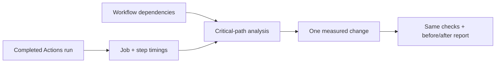
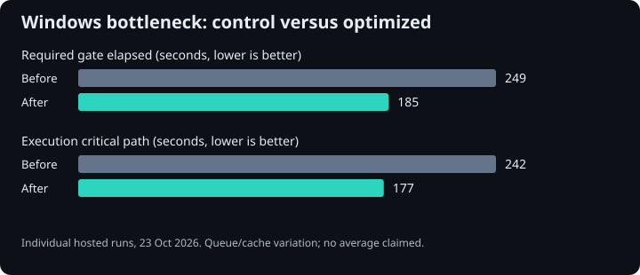
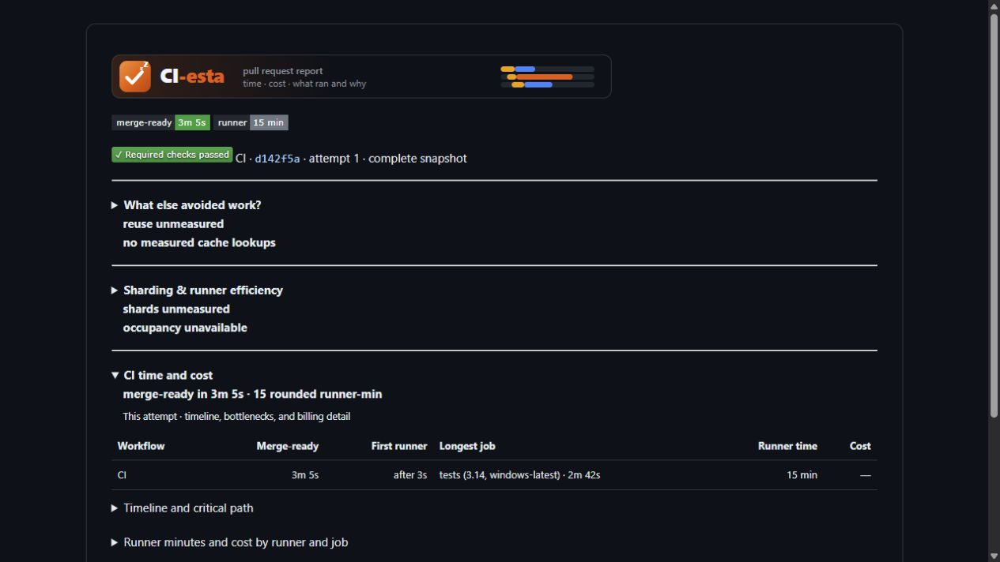

# Find what is delaying CI, then verify the improvement.

CI-esta reports GitHub Actions jobs, steps and dependency critical paths. Start
with a completed run, find the work delaying your required gate, and choose a
change you can measure: caching, parallel tests, lane selection or reuse of
previously completed equivalent work.

[Measure your first run](../docs/tutorials/measure-critical-path.md){ .md-button .md-button--primary }
[Add the reporting action](../docs/quickstart.md){ .md-button }

## Read a completed run

```bash
uv tool install 'ci-esta>=1.1.0,<2'
# Set GH_TOKEN or GITHUB_TOKEN through your credential mechanism.
ci-esta report --repository owner/project --run-id 123456 --run-attempt 1 \
  --gate 'Validation gate' --critical-path --output-dir report
```

Use your repository, run ID, attempt and exact required job name. The CLI needs
Python 3.11+ and read access to the run and workflow sources. Open
`report/ci-observability.md`; check collection completeness before trusting a
number. No hosted CI-esta account is needed.



## Use the report to choose a change

| What dominates | Next step |
| --- | --- |
| Repeated Python environment setup | [Validated environment caching](../docs/environment-cache.md) |
| Uneven test workers | [Learned timings and complete shards](../docs/learned-test-timings.md) |
| Unrelated jobs start on every edit | [pytest-selective lane routing](https://pytest-selective.readthedocs.io/en/latest/docs/tutorials/skip-unrelated-ci/) |
| Identical work already passed | [Completion evidence reuse](../docs/evidence-reuse.md) |
| A short job spends a long time waiting | [Critical paths and admission delays](../docs/critical-path.md) |

Keep the observer outside the validation gate. Reports do not grant a pass;
[required gates](../docs/selected-gates.md) still check every required test and
validator. Missing timings remain unavailable, and runner-seconds are not billing.

## One bottleneck, measured before and after



The Windows case retained all existing test outcomes. These are individual hosted
observations with runner variation, not a stable average. The [case study](../docs/benchmarks/2026-10-23-windows-saleor.md)
includes source runs, test inventories and the slower control that must not be
cherry-picked as the baseline.

## What the report looks like



Rendered from the CLI's real report for [run 39919114589, attempt 1](https://github.com/gigaverse-app/pytest-selective/actions/runs/39919114589).
The absent reuse and cache measurements stay unmeasured. Rounded runner-minutes
in the report are distinct from the unrounded runner-seconds used in comparisons.
[Report fields and interpretation](../docs/github-actions-observability.md).

## Related tools and support

[Choose a related tool](ecosystem.md) when you also need test selection, CI
measurement or background-work guarantees. Each project works independently.

`latest` follows main and can contain APIs newer than your installed package.
Check the release notes for that version. [Report an issue](https://github.com/gigaverse-app/ci-esta/issues)
with a minimal reproducer, or read [the contribution guide](../CONTRIBUTING.md).
