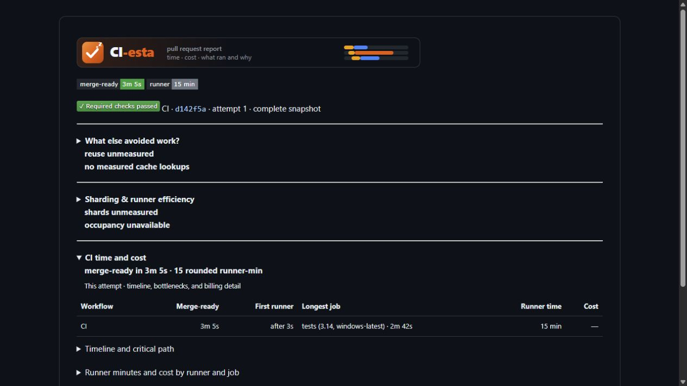

# Spend less time waiting for CI

Get your pull requests green sooner and spend less on GitHub Actions. CI-esta runs the checks your change needs, reuses passing results where it can, and splits the remaining tests across workers.

Free and open source under Apache 2.0. It runs in your existing workflows on hosted or self-hosted runners. You pay your usual runner costs.

## Try it on one pull request

Paste this into your coding agent from the root of your repository:

```text
Set up CI-esta in this repository. Fetch https://ci-esta.readthedocs.io/en/latest/agent-setup.md and follow it.
```

Your agent opens a pull request with the workflow changes and measurements. You can review which checks ran, how long you waited, and how much runner time they used.

[Quickstart](https://ci-esta.readthedocs.io/en/latest/docs/quickstart/){ .md-button .md-button--primary } [Adoption guide](https://ci-esta.readthedocs.io/en/latest/docs/tutorials/adoption-checklist/){ .md-button }

## What happens on your next push?

| When you… | CI-esta can… |
| --- | --- |
| Edit one function | Follow its dependencies and select the affected Python or Bun tests. |
| Push again after a passing run | Reuse a successful check when the recorded inputs and scope match. |
| Change code covered only by unit tests | Skip unrelated lanes. A lane is a group of checks, such as database integration tests, that CI can run or reuse independently. |
| Install the same dependencies repeatedly | Restore a matching environment, check it and sync it with your lockfile. |
| Wait on the last slow shard | Use recorded test durations to balance work across parallel workers. |

The PR report shows what ran, what was reused and which job kept you waiting. Scheduled full runs exercise the complete suite.

## How much time could you save?

A test gate that would take an estimated **52 minutes** to run the full suite on one runner took **5.1 minutes** on ordinary PRs. That's about **90% less waiting**. Your savings depend on how much work your changes touch. [See the case study](https://ci-esta.readthedocs.io/en/latest/case-study/).


