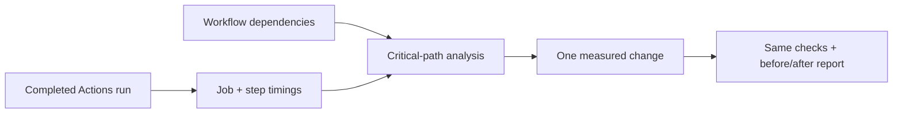
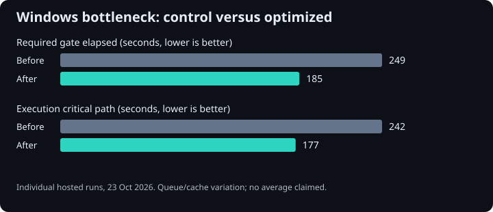

# Make pull requests faster with CI-esta

**Get a 10× shorter test gate when most tests are unrelated to a change.** In our Django monorepo, PRs reached the test gate in 5.1 minutes against an estimated 52 minutes for the full suite on one runner. Across the two backend repos, billed minutes per merged PR fell from 285 to 163. Cost per merged PR per 1,000 tests fell 29% in the monorepo and 38% in microservices. [Read the measurements](https://ci-esta.readthedocs.io/en/latest/case-study/).

- **Select affected tests.** Follow each change through Python or Bun dependencies to the tests that exercise it.
- **Reuse passing checks.** When a prior successful run proves the same inputs and scope, carry its result forward.
- **Plan reusable lanes.** A lane is a named group of checks, such as unit tests or integration tests, that CI can run, skip or reuse independently.
- **Cache dependencies.** Restore a matching environment, validate it and synchronize it with the lockfile.
- **Balance shards automatically.** Use timings from successful runs to distribute slow tests across parallel workers.
- **See what saved time.** The PR report shows the jobs that held up the gate and the total runner time they consumed. Full checkpoints still exercise the whole suite.

## Set it up with your coding agent

Give Claude Code, Codex, Cursor or any coding agent in your repository this one prompt:

```text
Set up CI-esta in this repository. Fetch https://ci-esta.readthedocs.io/en/latest/agent-setup.md and follow it.
```

The agent measures completed runs, makes one change the numbers support, proves it on the same commit with an
unchanged test inventory, and opens a draft pull request; merging, required checks and repository settings stay
with you. [Read the procedure it follows](../skills/ci-esta/SKILL.md), or set it up by hand:

[Measure your first run](../docs/tutorials/measure-critical-path.md){ .md-button .md-button--primary }
[Add the reporting action](../docs/quickstart.md){ .md-button }

## Read a completed run

```bash
uv tool install --upgrade --refresh 'ci-esta[selection]>=1.11,<2'  # --refresh: see releases from the last minutes
ci-esta --version                                                   # confirm the release on PATH
export GH_TOKEN="$(gh auth token)"   # or any token that can read the run
ci-esta report --repository owner/project --run-id 123456 --run-attempt 1 \
  --gate 'Validation gate' --critical-path --output-dir report
```

Use your repository, run ID, attempt and exact required job name. The CLI needs
Python 3.11+ and read access to the run and workflow sources. Open
`report/ci-observability.md`; check collection completeness before trusting a
number. No hosted CI-esta account is needed.



## Use the report to choose a change

| What dominates | Next step |
| --- | --- |
| Repeated Python environment setup | [Validated environment caching](../docs/environment-cache.md) |
| Uneven test workers | [Learned timings and complete shards](../docs/learned-test-timings.md) |
| Unrelated jobs start on every edit | [pytest-selective lane routing](https://pytest-selective.readthedocs.io/en/latest/docs/tutorials/skip-unrelated-ci/) |
| Identical work already passed | [Completion evidence reuse](../docs/evidence-reuse.md) |
| A short job spends a long time waiting | [Critical paths and admission delays](../docs/critical-path.md) |

Keep the observer outside the validation gate. Reports do not grant a pass;
[required gates](../docs/selected-gates.md) still check every required test and
validator. Missing timings remain unavailable, and runner-seconds are not billing.

## One bottleneck, measured before and after



The Windows case retained all existing test outcomes. These are individual hosted
observations with runner variation, not a stable average. The [case study](../docs/benchmarks/2026-10-23-windows-saleor.md)
includes source runs, test inventories and the slower control that must not be
cherry-picked as the baseline.

## What the report looks like


Rendered from the CLI's real report for [run 39919114589, attempt 1](https://github.com/gigaverse-app/pytest-selective/actions/runs/39919114589).
The absent reuse and cache measurements stay unmeasured. Rounded runner-minutes
in the report are distinct from the unrounded runner-seconds used in comparisons.
[Report fields and interpretation](../docs/github-actions-observability.md).

## Related tools and support

[Choose a related tool](ecosystem.md) when you also need test selection, CI
measurement or background-work guarantees. Each project works independently.

`latest` follows main and can contain APIs newer than your installed package.
Check the release notes for that version. [Report an issue](https://github.com/gigaverse-app/ci-esta/issues)
with a minimal reproducer, or read [the contribution guide](../CONTRIBUTING.md).
